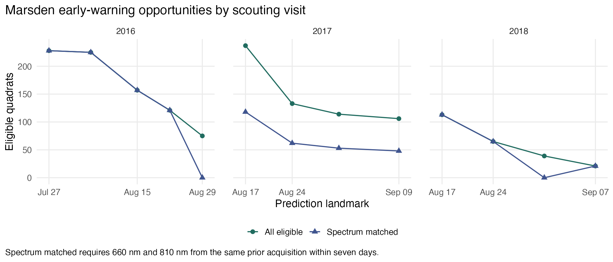

# Marsden early-warning eligibility and cropping-system baseline

November 22, 2026. This analysis predicts first recorded positive severity at the next scouting assessment for quadrats with no earlier or concurrent positive rating. The next visit had to occur within ten days. All observed follow-up gaps were 4–10 days across seasons. [Protocol](PROTOCOL.md)

## Eligible opportunities

The unit of evaluation is an eligible quadrat at a scouting visit. A quadrat can contribute more than once, and all of its records stay in the same held-out block. Spectrum matching requires a single acquisition with red and near-infrared measurements during the preceding seven days. It excludes same-day measurements with unknown acquisition order.

| Season | All eligible opportunities | Next-visit detections | Spectrum-matched opportunities | Matched detections | Matched plot-visits with both outcomes |
|---|---:|---:|---:|---:|---:|
| 2016 | 806 | 181 | 731 (91%) | 153 | 30 |
| 2017 | 590 | 131 | 281 (48%) | 70 | 16 |
| 2018 | 238 | 97 | 199 (84%) | 79 | 22 |

The 2017 spectral denominator covers only part of the disease cohort. The rule also leaves no matched spectra for the August 29, 2016 and August 31, 2018 landmarks. Both landmarks contribute detections in the all-eligible cohort. Evaluate any spectral model against the baseline on exactly the same matched rows. [Coverage by landmark](landmark_coverage.csv) · [Within-plot support](within_plot_support.csv)

## Leave-one-block-out baselines

The table shows the primary outcome on spectrum-matched rows. Lower Brier scores indicate more accurate probabilities. Within-block AUROC ranks positive and negative outcomes scored by the same held-out model and gives a constant score 0.50.

| Season | Constant Brier | Cropping-system Brier | Visit Brier | Visit × cropping-system Brier | Cropping-system within-block AUROC |
|---|---:|---:|---:|---:|---:|
| 2016 | 0.166 | 0.160 | 0.150 | **0.136** | 0.647 |
| 2017 | 0.196 | 0.176 | 0.155 | **0.140** | 0.816 |
| 2018 | 0.249 | 0.253 | **0.247** | 0.268 | 0.571 |

Cropping system alone improved probability accuracy over constant risk in 2016 and 2017. Including the known visit also helped in both seasons. In 2018, cropping system ranked outcomes modestly above chance within held-out blocks, but its Brier score was slightly worse than constant risk on the matched records. The visit interaction also performed worse than constant risk. The result depends on eligibility. Cropping system alone improved the 2018 all-eligible Brier score from 0.257 to 0.250. All four baselines give the same score to quadrats sharing a plot and landmark. [Metrics for both denominators](baseline_metrics.csv) · [Held-out block metrics](block_metrics.csv)

## Endpoint sensitivity

Changing the threshold from any positive severity to 5% changes the at-risk set and the detection target. In 2018, the matched risk set increases from **199 to 280 opportunities**, while next-visit detections fall from **79 to 34**. Only **12** matched plot-visits have both outcomes under the 5% endpoint, compared with 22 at the primary threshold. Treat 5% as an alternate symptom target and preserve both eligibility tables. [Endpoint coverage](landmark_coverage.csv) · [Baseline comparisons](baseline_comparison.csv)

The next analysis is a latest-spectrum comparator on the frozen matched rows and whole-block folds, against both cropping-system-only and visit-aware baselines. Check within-plot discrimination on the mixed-outcome strata before trying trajectory features. These results describe held-out blocks within each season.

## Reproduce

From the repository root, generate the [disease registry and bounds](../../analysis/08_marsden_disease_seasons.R), then run `Rscript analysis/09_marsden_early_warning.R`. The optional arguments are the output directory and the upstream disease-analysis directory. Full eligibility and prediction rows are stored in the ignored `local/` directory. [R script](../../analysis/09_marsden_early_warning.R) · [Software versions](software.csv)
