# Executive summary

The clearest recurring result is a cropping-system difference in recorded disease severity. At Marsden, S4 had the lowest final mean severity in all three seasons. Its advantage varied considerably, and the S2–S3 ordering reversed in 2018. Analyses that aligned quadrats at first recorded symptoms identified differences in the fraction detected and in subsequent severity. The size and interpretation of these components depended on the season, threshold, and interval between visits.

The first functional severity mode largely recovered conventional disease burden. Some quadrats with similar time-weighted mean severity had very different final severity, chiefly in 2016. Higher modes described a smaller fraction of variation, and the held-out yield comparisons offered little evidence that they improved on simple disease summaries. At Hinds, final severity, AUDPC, and onset together improved yield prediction over the treatment-only baseline in both rating versions.

The handheld reflectance results depend on the comparison being made. Adjusted concurrent red and near-infrared associations were small or sensitive to date and block. The latest pair of bands ranked quadrats within a plot-visit in 2018, with first-positive severity AUROC of 0.702 against 0.500 for plot-visit-constant baselines. This local ranking gain did not produce the best season-wide probability predictions. History features failed to improve consistently on the latest pair, and the simple spectral transfer model failed to beat the cropping-system baseline on Brier score in every held-out year.

The exploration addresses all eight questions with the available data. The decision record at the end identifies which findings are sufficiently supported to carry forward, which are descriptive, and which would require records or validation that this dataset cannot supply.

## Question-by-question results

| Question | Main result |
|---|---|
| Q1. Treatment trajectories | S4 ends lowest in three seasons. Whole-curve separation is strongest in 2016. Visit means predict held-out plot-visit severity as well as the bounded smooth and growth comparators. |
| Q2. Timing and progression | Detection contributes to the S2–S4 severity gap, especially in 2017. Onset alignment selects different quadrats and follow-up periods. |
| Q3. Epidemic shape | The leading within-plot mode explains 83–97% of severity variation and correlates at least 0.98 with time-weighted mean severity. The best support for distinctions among similar-burden curves is in 2016. |
| Q4. Disease and spectra | Strong pooled associations can weaken or change sign after adjustment or when the final matched date is omitted. |
| Q5. Incidence and severity | They share major variation at both sites. Hinds source and denominator choices affect early incidence interpretation. |
| Q6. Disease and yield | Conventional summaries help most in Hinds 2018 and Marsden 2016. Functional scores show no consistent incremental improvement. |
| Q7. Early warning | Latest spectra improve within-plot ranking in Marsden 2018. Slopes and curvature add no consistent gain. |
| Q8. Recurrence and transfer | S4's final severity ordering recurs. Effect sizes and spectral utility vary by season. This transfer evaluation covers new blocks and years at Marsden. |

# Data and experimental design

The field series contain foliar severity and incidence observations, canopy reflectance at eight wavelengths from 460 to 810 nm, and selected harvest observations. Original dates are retained. Marsden has four blocks per year, each with one soybean main plot per cropping system (S2, S3, S4) and multiple quadrats per plot. Hinds 2018 has six blocks, two cultivars, and five assigned doses. Its microplot is the sampling and treatment unit. The annual Marsden plant samples and assessment windows differ. The estimand is a comparison of recorded soybean plots in each year.

| Site/year | Disease units | Disease dates | Reflectance units | Reflectance dates | Yield units |
|---|---:|---:|---:|---:|---:|
| Marsden 2016 | 240 | 6 | 240 | 12 | 240 |
| Marsden 2017 | 240 | 5 | 120 | 10 | 103 |
| Marsden 2018 | 115 | 5 | 127 | 8 | 115 |
| Hinds 2018 | 60 | 8 | 60 | 7 | 60 |
| Marsden 2019 | -- | -- | 120 | 8 | -- |
| Hinds 2019 | -- | -- | 60 | 10 | -- |

Only 115 Marsden 2018 units enter disease–spectra joins. The Hinds 2019 GIS sheet duplicates 2018 disease data, and a 2019 Hinds rating template is blank. The calendar confirms visits but supplies no unit outcomes. Both 2019 series contribute coverage and reflectance exploration only.

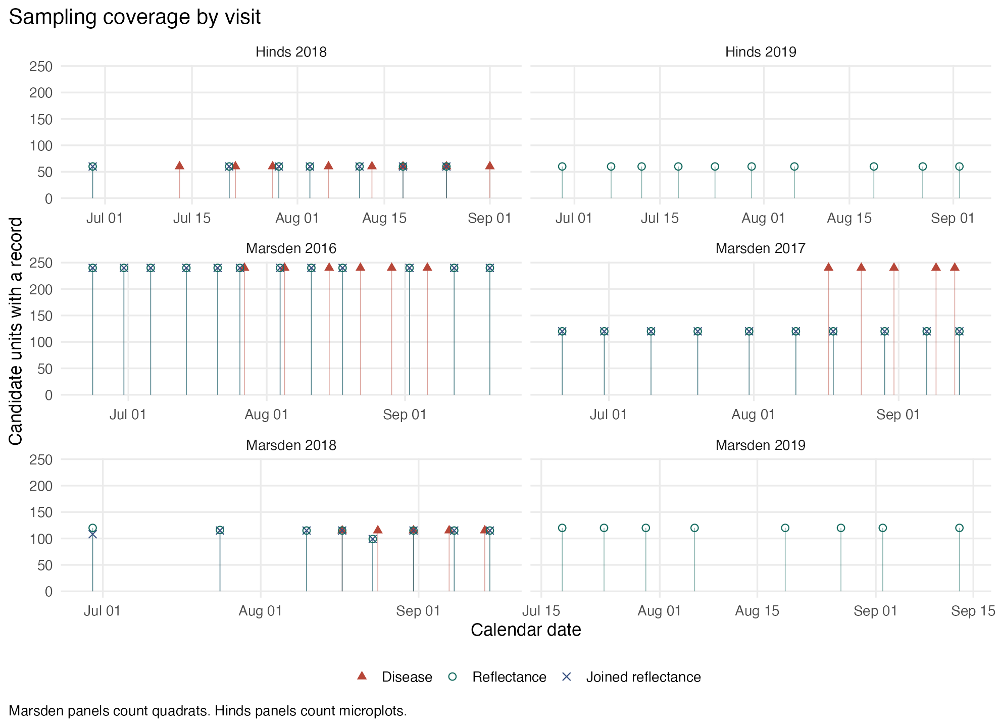{width=95%}

## Source decisions

- Marsden 2017 disease analyses use all 240 rated quadrats. Disease–spectra analyses use the verified quadrat IDs and disease-registry assignments. A six-quadrat June 30 metadata correction is backed by the logger and tag sequence. The 2018 phase diagram corroborates the 12 disease-registry rotations.
- Hinds comparisons use plot keys from the original experiment sheet, field severity from the long sheet, and harvest IDs verified against the combine sequence. The historical repository disease–yield join is quarantined because of conflicting plot assignments. The alternate reproductive-stage severity entries are retained as a sensitivity version.
- Two Hinds August 3 acquisitions have unresolved identities for plots 507 and 508. Both were excluded. A second analysis removes the full August 3 acquisition date to check dependence on that visit.
- A field reading is treated as a dated record. Recorded first positive defines detection between two visits where both bounds exist. Biological infection time is unobserved. Harvest analyses use verified recorded yields on the available cohorts.

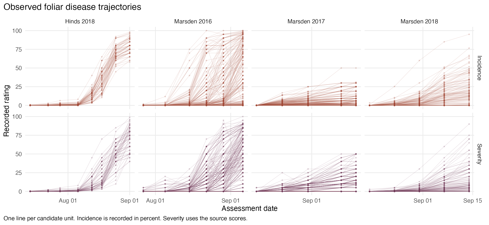{width=100%}

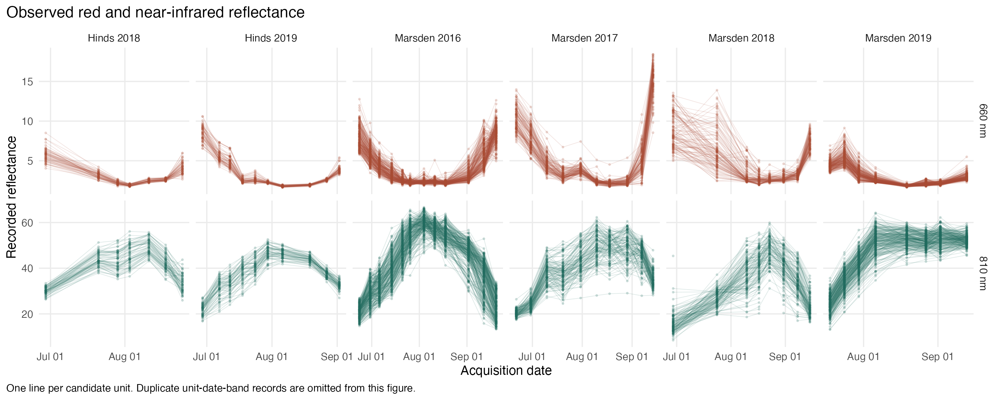{width=100%}

# Disease trajectories and recorded detection

## Q1. Cropping-system and treatment differences

The primary Marsden summary gives each plot equal weight. The conditional whole-curve test permuted complete plot profiles across the three rotation labels within each block, for 1,296 assignments per season. This calculation assumes exchangeability under the sharp null for the included plots. The test and descriptive intervals are conditioned on the observed sampling and assignment structure. Across seasons, differing assessment dates and sampled quadrats also affect what can be compared.

| Year | S2 final % | S3 final % | S4 final % | Whole-curve tail area | Visit RMSE | Spline RMSE | Growth RMSE |
|---|---:|---:|---:|---:|---:|---:|---:|
| 2016 | 71.4 | 38.4 | 24.9 | 0.023 | 10.47 | 10.51 | 10.52 |
| 2017 | 17.9 | 14.7 | 1.6 | 0.088 | 5.16 | 5.18 | 5.19 |
| 2018 | 17.1 | 19.0 | 9.0 | 0.616 | 8.36 | 8.36 | 8.37 |

RMSE is in severity percentage points, for whole-block holdouts of plot-visit means. The bounded smooth uses a three-column natural spline. The growth comparator estimates an upper limit, midpoint and rate with zero lower limit. The original 2016 unconstrained spline reduced RMSE by only 0.05 points and produced 11 below-zero predictions in 72 visits. The visit factor remains the working comparator and the observed 5–6 assessments per year give limited support for biological interpretations of fitted derivatives.

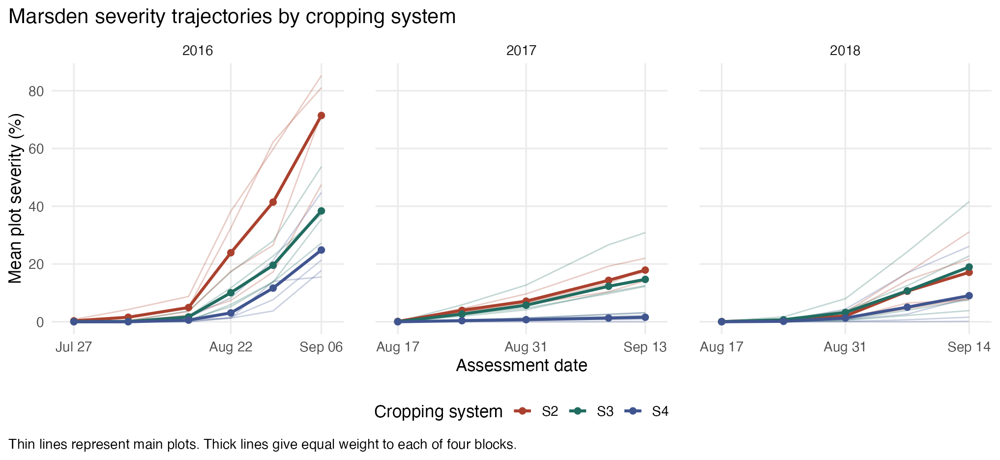{width=97%}

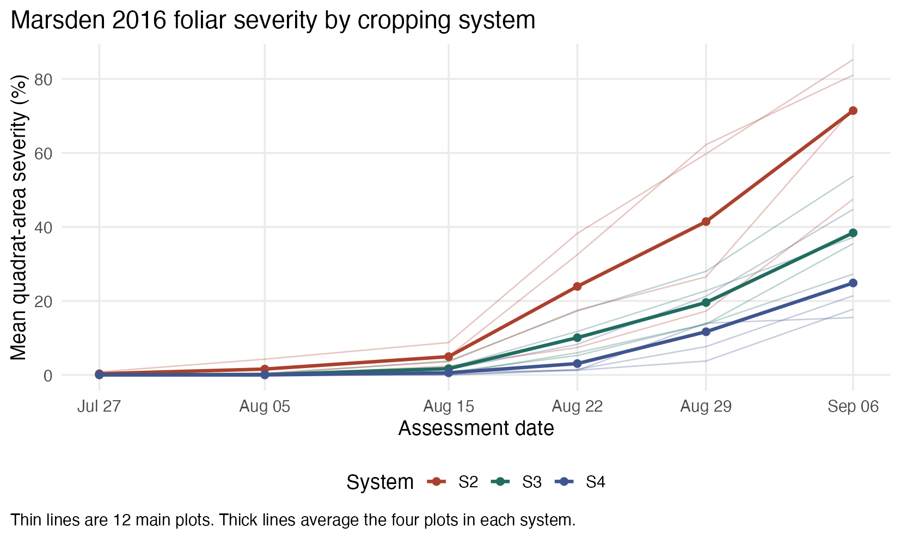{width=85%}

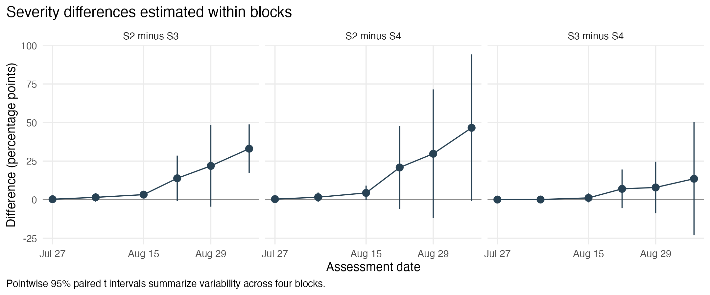{width=88%}

In 2018, excluding the block with smaller S3 and S4 samples reduced the final S2–S4 gap from 8.09 to 3.60 points. At Hinds, the six-block final severity contrast was +2.03 points for Pioneer P20T79R2 versus Syngenta NK S24-K2 (pointwise 95% interval -8.07 to +12.14), and -2.92 points for mean nonzero dose versus control (-8.36 to +2.52). These are marginal contrasts, with the same final ratings under both source versions.

## Q2. Detection timing versus subsequent severity

A first-visit positive is left-censored. A first positive after a negative places detection within the intervening interval. A quadrat without a positive rating by the final visit is right-censored. The scheduled-date cumulative detection curve uses the empirical risk set and makes no assumption about the time of crossing within an interval.

By the last visit in 2017, the equal-block fraction ever positive was 92.5% for S2 and 13.8% for S4. Compared with any positive severity, a threshold of at least 5% changed first-positive timing or detection status in 27 of 240 quadrats in 2017 and 95 of 115 in 2018. For Hinds, field entries advanced first-positive detection by 9 and 22 days in two plots. Five percent severity and final severity agreed across versions. On August 6 the nonzero-dose minus control cumulative detection contrast shifted from 0 to -8.33 points under the alternate version.

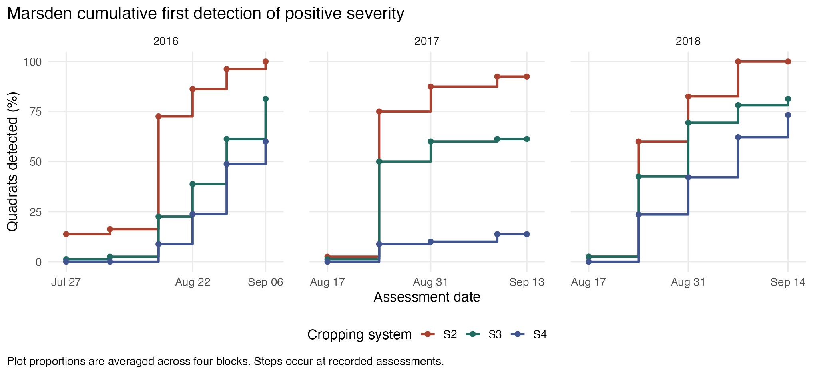{width=96%}

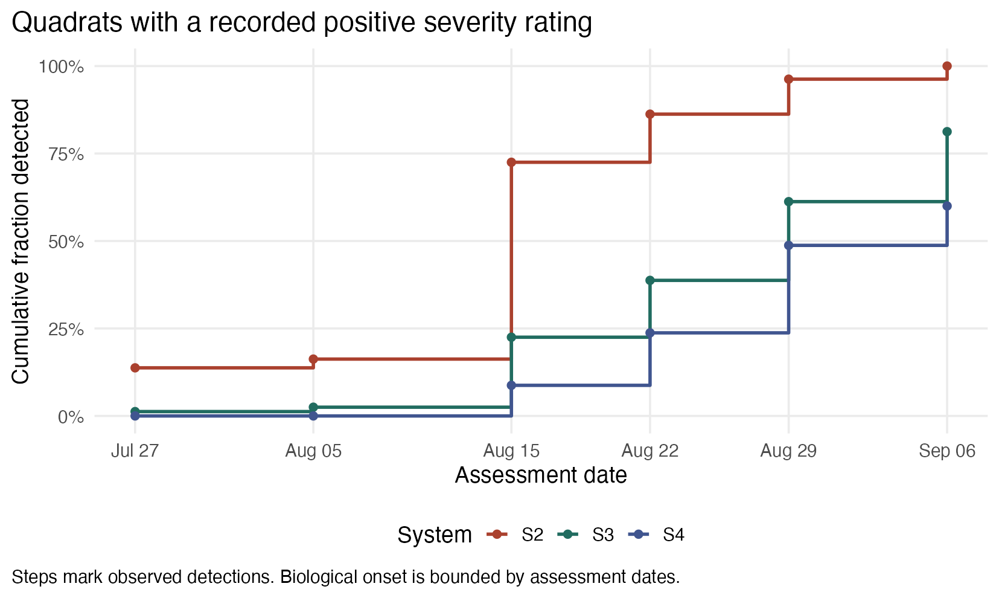{width=83%}

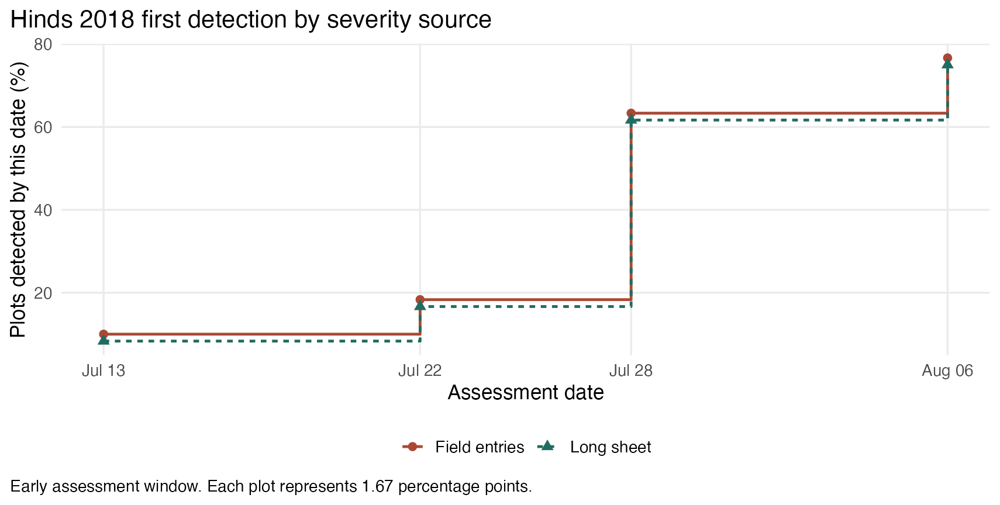{width=92%}

| Marsden S2 minus S4 | Fraction detected component | Severity among detected component | Block pairs |
|---|---:|---:|---:|
| 2016 | 23.3 pp | 23.3 pp | 4 |
| 2017 | 10.8 pp | 3.7 pp | 3 |
| 2018 | 3.5 pp | 4.6 pp | 4 |

This is a decomposition of the final mean, with symmetric weighting of the two factors. In 2017, one S4 plot had zero detections and its positive-group mean was undefined. Comparing severity 8–14 days after first recorded detection, the 2016 means were 44.6% for S2 and 36.4% for S4, with 55 and 27 contributing quadrats. The 2018 means were 12.2% and 8.3%, with 32 and 16 quadrats. Only one S4 quadrat contributes to the corresponding 2017 window. These aligned summaries describe the observed subsets, which differ in onset and follow-up coverage. They cannot separate a treatment effect on progression from selection into the detected group.

# Functional disease patterns and joint signals

## Q3. Within-plot severity modes

Severity curves were linearly interpolated within the observed annual windows on a one-day grid. Each quadrat's curve was centered on its own main plot mean, so the analysis targets within-plot heterogeneity. Plots have equal weight. Leave-one-block-out comparisons assess the loading direction and the subspace spanned by the leading two directions. A cosine of one indicates complete alignment.

| Year | PC1 variance | PC2 variance | Min. PC1 cosine | Min. rank-2 cosine | PC1 / mean severity correlation | Similar-burden pairs with final gap of 10+ pp |
|---|---:|---:|---:|---:|---:|---:|
| 2016 | 83.3% | 10.6% | 0.997 | 0.991 | 0.984 | 85 / 361 |
| 2017 | 92.9% | 4.4% | 1.000 | 0.957 | 0.989 | 16 / 934 |
| 2018 | 96.7% | 2.3% | 1.000 | 0.964 | 0.993 | 1 / 153 |

Similar-burden pairs are within the same plot and within one percentage point of trapezoidal time-weighted mean severity. Pairs share quadrats. Their counts describe observed shape heterogeneity and give no independent replicates. PC2 carries a smaller amount of shape variation. Its loading signs are arbitrary, and the analysis supplies no stable cross-season class definition. Continuous severity summaries and the component scores retain the information supported by these curves.

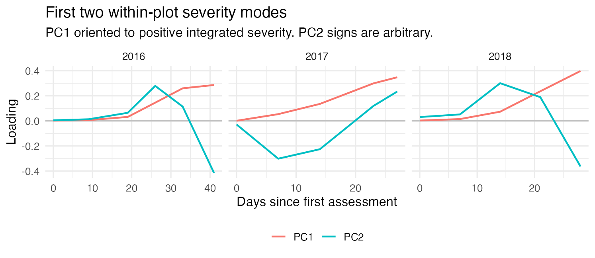{width=100%}

## Q4. Disease and canopy reflectance

Retrospective pairs use the latest same-day or prior complete spectrum within four days. They address contemporaneous association, unlike the strictly pre-landmark prediction below. The Marsden fit controlled for quadrat and plot-by-visit effects within block. The Hinds fit controlled for plot and visit within block, with one rating per microplot-visit. The adjusted slopes are reflectance percentage points per 10 points of severity.

\Needspace{8\baselineskip}

| Trial | Paired assessment dates | Paired rows per band | 660 nm adjusted slope | 810 nm adjusted slope |
|---|---:|---:|---:|---:|
| Marsden 2016 | 5 | 1,200 | +0.052 | -0.166 |
| Marsden 2017 | 2 | 240 | +0.015 | +0.565 |
| Marsden 2018 | 3 | 329 | +0.125 | -2.501 |
| Hinds 2018 | 5 | 298 | -0.023 | +0.471 |

Every primary Marsden pointwise between-block interval covered zero. The adjusted 2017 near-infrared mean was positive even though three of the four block slopes were negative. Omitting the latest eligible assessment reversed the near-infrared estimate in 2016 and 2018. The 2017 within-quadrat model requires both dates. At Hinds the pooled slopes were +0.261 red and -2.016 near infrared. After plot and visit adjustment both signs changed. Omitting the latest eligible date changed the adjusted slopes to +0.060 and -0.744. The source-version difference in the Hinds primary estimates was less than 0.002 for either band. With strictly prior dates the slopes were +0.070 and -0.820. Dropping the entire disputed acquisition date gave -0.021 and +0.870. The sparse paired windows and the final-date sensitivity constrain interpretation of joint spectral-disease modes across seasons.

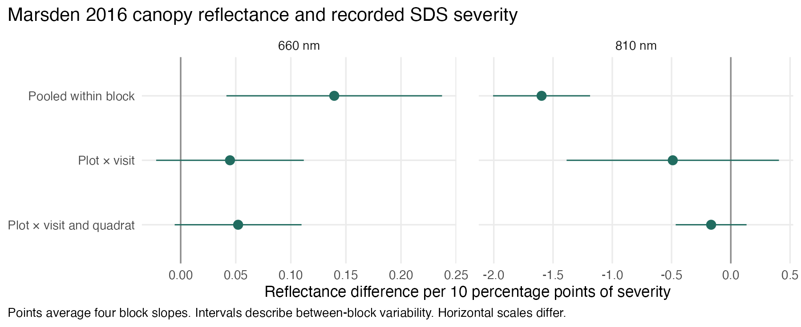{width=94%}

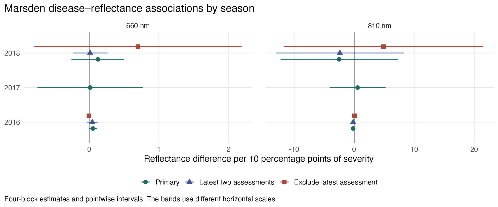{width=97%}

## Q5. Incidence and severity

Joint FPCA centers the two outcomes within Marsden plots, with equal total residual variation assigned to each outcome. PC1 explains 75.1%, 83.3% and 89.6% in 2016–2018, with minimum leave-one-block-out cosine of 0.996 across seasons. The corresponding within-plot AUDPC correlations are 0.853, 0.752 and 0.890. Correlation varies with assessment time and reflects the recorded scales.

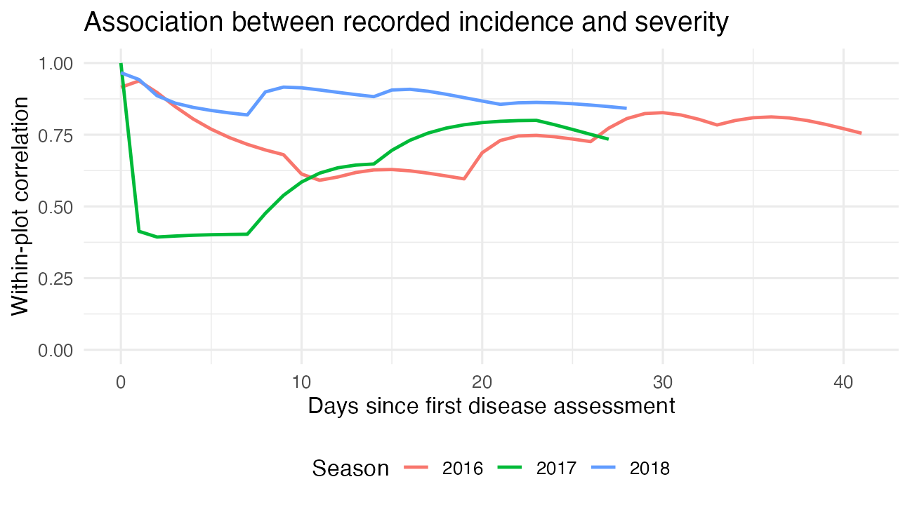{width=90%}

At Hinds, the reproductive-stage workbook denominator reproduces **328 of 329** recorded incidence percentages where symptomatic plant counts exist. The separate stand register reproduces **151 of 329**, including records where the numerator is zero. Denominators agree for eight of 60 plot keys. The alternative denominator changes the August 18 median among the 29 comparable observations by 1.84 points in absolute value. The final two dates lack symptomatic plant counts. Three incidence cells differ between long and wide versions. Therefore the joint comparison uses recorded percentages and shows both versions. On July 28 the block- and treatment-adjusted incidence–severity correlation is 0.790 in the long sheet and 0.522 in the entry sheet. The workbook denominator explains historical calculations for most early entries. Its assignment of stands to plots remains unresolved.

# Disease history and yield

## Q6. Incremental information in complete disease curves

The 2016 Marsden workbook uses an explicit 67.25 conversion from bu/ac to kg/ha and agrees with disease block, plot and cropping system keys. For 2017 the harvested 103 records match the joined sheet with the `buacA` adjustment. All 12 soybean plots contribute, with 39 S2, 32 S3 and 32 S4 harvested quadrats among 240 rated. The 2018 adjustment workbook is an exact value match for the 115 linked quadrats. Hinds uses 60 sequence-verified adjusted plot yields.

Leave-one-block-out comparisons used equal plot weights. Each component model estimates its daily severity basis on training plots only, then projects held-out curves onto the two training components. Disease terms use a fixed ridge penalty. Baselines comprise the assigned treatment and one or more conventional disease summaries. Full-season severity inputs make this a retrospective disease–yield association.

| Trial | Harvested units | Treatment | Final | AUDPC | Onset | Summaries | Functional | Both |
|---|---:|---:|---:|---:|---:|---:|---:|---:|
| Marsden 2016 | 240 | 9.07 | 8.56 | 8.02 | 8.33 | 8.22 | 8.11 | 8.18 |
| Marsden 2017 | 103 | 7.30 | 7.30 | 7.30 | 7.55 | 7.55 | 7.31 | 7.55 |
| Marsden 2018 | 115 | 11.19 | 11.87 | 11.91 | 12.42 | 12.74 | 11.75 | 12.70 |
| Hinds 2018 | 60 | 4.29 | 3.46 | 3.33 | 4.32 | 3.15 | 3.37 | 3.41 |

Cells are held-out RMSE in bu/ac. All models include treatment. Summaries combine final severity, AUDPC and onset. Functional uses two severity components. Both combines the summaries and components. For the alternate Hinds severity version, the summaries model had RMSE 3.15 versus 4.29 for treatment alone, and the combined model had RMSE 3.39. Existing published work already associates foliar symptom timing with disease intensity and yield, including these Marsden seasons. Here the incremental result is the identical-cohort block-held-out comparison of conventional and functional representations. [Published onset and yield study](https://apsjournals.apsnet.org/doi/10.1094/PDIS-07-21-1551-RE)

# Early warning and transfer

## Q7. Latest spectrum and pre-landmark history

The primary endpoint is first recorded positive severity at the next assessment within ten days. At the landmark, an eligible quadrat has shown no positive rating to date. A matched spectrum uses 660 and 810 nm from the same acquisition 1–7 days before the landmark. The two-band logistic model adds to the smoothed visit-by-cropping-system risk. Preprocessing, offset estimation and fitting use training blocks only. Incidence and severity of at least 5% define separate risk sets and sensitivity checks.

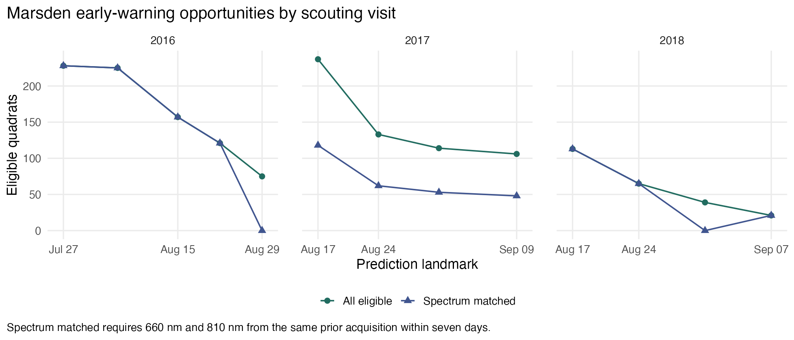{width=98%}

| Year | Events / matched | Brier crop | Brier visit | Brier visit × crop | Brier + spectra | AUC + spectra | AP + spectra | Within plot-visit AUC |
|---|---:|---:|---:|---:|---:|---:|---:|---:|
| 2016 | 153 / 731 | 0.1596 | 0.1497 | 0.1360 | 0.1364 | 0.806 | 0.481 | 0.503 |
| 2017 | 70 / 281 | 0.1759 | 0.1553 | 0.1399 | 0.1386 | 0.826 | 0.503 | 0.510 |
| 2018 | 79 / 199 | 0.2531 | 0.2472 | 0.2682 | 0.2643 | 0.595 | 0.410 | 0.702 |

AUC is pair-weighted within block. AP is pooled average precision. Within-plot-visit AUROC gives ties half credit and weights positive–negative pairs equally. Its baseline is 0.500. The 2018 estimate reflects 265 pairs in 22 mixed-outcome plot-visits and ranged from 0.653 to 0.865 across blocks. AUROC within plot-visit was 0.696 for incidence and 0.642 for severity at least 5% in 2018. At the higher threshold, adding spectra worsened Brier score from 0.1095 to 0.1189 against the visit-by-cropping-system offset.

| Alternate endpoint | Year | Detections / matched | Brier offset | Brier + spectra | Within-plot AUC + spectra |
|---|---:|---:|---:|---:|---:|
| Severity at least 5% | 2016 | 160 / 758 | 0.1456 | 0.1451 | 0.509 |
| Severity at least 5% | 2017 | 70 / 291 | 0.1631 | 0.1649 | 0.489 |
| Severity at least 5% | 2018 | 34 / 280 | 0.1095 | 0.1189 | 0.642 |
| Positive incidence | 2016 | 148 / 731 | 0.1336 | 0.1347 | 0.506 |
| Positive incidence | 2017 | 70 / 281 | 0.1399 | 0.1386 | 0.510 |
| Positive incidence | 2018 | 80 / 198 | 0.2645 | 0.2627 | 0.696 |

To test history, fit per-quadrat red and near-infrared slopes on the observed acquisitions in the prior 21 days. On a separate cohort with three or more acquisitions, add quadratic time-basis coefficients. Re-estimate baselines on each identical denominator. In 2018, requiring two acquisitions retains 86 of 199 primary opportunities. A third acquisition reduces this to 64. Requiring three in 2017 retains 53 of 281 and five detections.

| Year, minimum observations | Rows / events | Latest Brier | + slopes Brier | + curvature Brier | Latest plot AUC | + slopes plot AUC | + curvature plot AUC |
|---|---:|---:|---:|---:|---:|---:|---:|
| 2016, two | 731 / 153 | 0.1364 | 0.1361 | -- | 0.503 | 0.469 | -- |
| 2017, two | 281 / 70 | 0.1386 | 0.1352 | -- | 0.510 | 0.460 | -- |
| 2018, two | 86 / 31 | 0.2832 | 0.2752 | -- | 0.500 | 0.478 | -- |
| 2016, three | 731 / 153 | 0.1364 | 0.1361 | 0.1400 | 0.503 | 0.469 | 0.462 |
| 2017, three | 53 / 5 | 0.1008 | 0.1031 | 0.1046 | 0.524 | 0.762 | 0.810 |
| 2018, three | 64 / 25 | 0.3375 | 0.3532 | 0.3501 | 0.484 | 0.500 | 0.563 |

The models with slopes lowered Brier score slightly on the two-acquisition cohorts but lowered within-plot-visit AUROC in every season. The three-acquisition 2017 ranking gain is based on five detections and 21 positive–negative within-plot-visit pairs, with higher Brier error. In 2018 the within-plot-visit AUROC of the latest pair fell to 0.500 when restricted to two-acquisition rows, compared with 0.702 on the complete matched cohort. Thus the history requirement changes the evaluated population materially. Complete model-by-endpoint metrics, including the history sensitivities, are in the output index. This experiment supports a comparison of low-order history features. It gives little basis for fitting a more flexible curve to these prefixes.

## Q8. Recurrence across seasons and out-of-year transfer

On the common August 17–September 6 window, the within-block S2 minus S4 time-weighted mean severity gap was 27.87, 4.99 and 1.11 points in 2016, 2017 and 2018. This suggests the size of the contrast varies even after using common calendar limits. Calendar windows still cover different crop and epidemic stages. No single Hinds treatment maps to the Marsden rotation contrast.

The transfer test uses Marsden-only predictors. The archived numbered layout and cropping-phase diagrams show the same four physical blocks across seasons. For each target year and block, training uses the other two years and the other three blocks. This excludes the four recurring 2016–2018 S2 plots from the training data for predictions on those plots. Use a common calendar day and training cropping-system probabilities, with an optional latest spectrum added jointly with the calendar term. The scored outcomes and spectral timing match the latest-spectrum milestone.

| Held-out year | Cropping Brier | + calendar Brier | + calendar & spectra Brier | Spectral AUC | Spectral AP | Target dates outside training support |
|---|---:|---:|---:|---:|---:|---:|
| 2016 | 0.182 | 0.376 | 0.416 | 0.494 | 0.207 | 610 / 731 rows |
| 2017 | 0.157 | 0.248 | 0.248 | 0.530 | 0.261 | 48 / 281 rows |
| 2018 | 0.247 | 0.235 | 0.279 | 0.697 | 0.551 | 0 / 199 rows |

In 2018 the spectral model ranked events slightly better than its calendar-and-cropping counterpart, while it predicted mean risk **0.165** against observed prevalence **0.397**, and had higher Brier error. At a 20% per-block opportunity budget, both models captured 31.6% of detections. In 2016 most target rows fall outside both source years' calendar support. These are same-farm results across three held-out seasons. Independent transfer to Hinds would require a compatible scoring schedule, design and calibration with an appropriate external validation cohort.

# Decisions for future direction

| Finding | Evidence to carry into a decision |
|---|---|
| Treatment epidemiology | The clearest empirical result is annual treatment trajectories and differences in detection and subsequent severity. Common-calendar and 2018 sample-size checks show how much effect sizes vary. A manuscript would need to distinguish this result from prior rotation and onset work. |
| Functional phenotyping | The first mode largely summarizes disease burden, and a subset of 2016 pairs shows different end-of-season severity at similar burden. The observed dates support continuous descriptions and limited shape comparisons. |
| Disease–reflectance interpretation | Adjusted associations and within-plot prediction answer different questions. The 2018 within-plot ranking gain merits description with its denominators, calibration and endpoint sensitivity. |
| Yield | Conventional summaries earn the strongest support in Marsden 2016 and Hinds 2018. The prior onset publication overlaps directly. A new yield contribution would need evidence beyond the conventional predictors on held-out blocks. |
| Prospective validation | Unequal prior-spectrum coverage and differing visit calendars constrain early warning. Future collection would need repeated pre-symptom paired spectra, time-ordered acquisitions, and an independent validation environment. |

The earlier Marsden satellite study analyzed disease classification with high-resolution imagery, and the subsequent GRU study examined time-series satellite classification. This exploration instead uses handheld band pairs, first-detection risk sets, and whole-block or joint block-and-year holdouts. The comparisons identify methodological differences and overlapping data lineage. They do not establish priority for any research claim. [Raza et al., satellite study](https://www.mdpi.com/2072-4292/12/7/1213) · [Bi et al., satellite time-series study](https://www.mdpi.com/2072-4292/12/21/3621)

## Analysis boundaries

- Hinds stand-to-plot reconciliation requires original counting or correction records. Early workbook percentages and later counts-free assessments can be compared as recorded, while an exact count-denominator model for the full season remains unsupported.
- One disputed Hinds acquisition pair and gaps in Marsden 2018 sampling have traceable exclusions and sensitivity checks. The 2019 labeled outcomes remain unavailable.
- Retrospective paired-date results supply limited support for multichannel joint disease–reflectance inference. Four Marsden blocks per season and nonmatching epidemic stages limit seasonal inference, functional derivatives, and broader environmental contrasts.
- Yield models are associations in harvested units, particularly in the 2017 subset. Harvest selection and alternate 2017 moisture adjustments remain relevant to wider interpretation.
- The research owner can use this evidence to select a manuscript direction and a focused hypothesis family. The analyses in this report are exploratory.

# Reproducibility and output index

The repository records SHA-256 checks for source tables and the archive workbooks. The documented root `SDS_PAPER_ROOT` points to the archive containing `04_source_data`. Run from the repository root with R 4.5.3. The closing scripts used dplyr 1.2.1, tidyr 1.3.2, ggplot2 4.0.2, digest 0.6.39, ragg 1.5.2 and readxl 1.4.5. All source files were read in place. Scripts keep detail data and predictions under ignored `local/` folders. The report uses figures generated by the audit and analysis scripts and rounds aggregate values for readability.

Output paths below are relative to the repository root. Files named in the second table are in `results/exploration/`.

| Evidence | Repository directory |
|---|---|
| Source inventories, discrepancies and archive corroboration | `audit/` |
| Q1–Q2, severity contrasts and detection | `results/phase2/`, `results/marsden_disease/` |
| Hinds severity-version checks | `results/hinds_severity/` |
| Q4, Marsden date support and block slopes | `results/phase3/`, `results/phase3_seasons/` |
| Q7, eligibility and latest-spectrum model metrics | `results/early_warning/` |

| Closing evidence | File or filename pattern |
|---|---|
| Bounded models, onset-aligned summaries and disease functional modes | `disease_*.csv` |
| Hinds incidence reconstruction and pairing checks | `hinds_*.csv` |
| Harvest coverage and model performance | `yield_*.csv` |
| Within-season history cohorts and model metrics | `warning_history_coverage.csv`, `warning_trajectory_metrics.csv` |
| Common-window treatment contrasts and transfer | `disease_common_window.csv`, `warning_transfer_metrics.csv` |

```sh
Rscript --vanilla analysis/03_prepare_phase2.R results/phase2 "$SDS_PAPER_ROOT"
Rscript --vanilla analysis/04_marsden2016_baseline.R
Rscript --vanilla analysis/05_marsden2016_reflectance.R
Rscript --vanilla analysis/06_marsden_reflectance_seasons.R
Rscript --vanilla analysis/07_hinds2018_severity_sensitivity.R
Rscript --vanilla analysis/08_marsden_disease_seasons.R
Rscript --vanilla analysis/09_marsden_early_warning.R
Rscript --vanilla analysis/10_marsden_latest_spectrum.R
Rscript --vanilla analysis/11_marsden_trajectory_warning.R
Rscript --vanilla analysis/12_marsden_functional_disease.R
Rscript --vanilla analysis/13_sds_yield.R "$SDS_PAPER_ROOT"
Rscript --vanilla analysis/14_hinds_incidence_reflectance.R "$SDS_PAPER_ROOT"
```

A clean run of scripts 03–14 in fresh directories reproduced all 103 generated CSVs byte for byte, including the ignored detail tables.

The closing models and choices are recorded in `results/exploration/PROTOCOL.md`. Build the PDF with Pandoc and XeLaTeX from the repository root.

```sh
pandoc results/exploration/REPORT.md --pdf-engine=xelatex \
  --resource-path=results/exploration \
  -o output/pdf/soybean-sds-research-exploration.pdf
```
