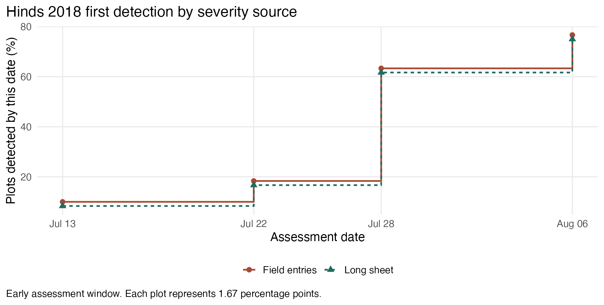

# Hinds 2018 severity-version sensitivity

November 22, 2026. Compared the archived `SDS` long sheet and `Reproductive Stage` field entries for the same 60 microplots, eight assessment dates, and 480 plot-date ratings. Three early ratings differed across two plots. [Protocol](PROTOCOL.md)

## First observed symptoms

Using any positive severity, the field entries move first detection earlier by **9 days** on one plot and **22 days** on another. One plot changes from an interval-censored detection in the long sheet to a first-visit positive in the field entries. The two versions give five versus six first-visit positives, respectively. All 60 plots had a positive severity rating by August 13 in both versions. [Detection comparison](detection_version_comparison.csv) · [Censoring counts](censoring_counts.csv)

| Detection endpoint | Plots with differing first-positive dates | Plots with differing censoring classes |
|---|---:|---:|
| Severity above zero | 2 of 60 | 1 of 60 |
| Severity at least 5% | 0 of 60 | 0 of 60 |

The 5% endpoint describes reaching a higher disease threshold. The source choice matters for the first visible symptoms when low recorded scores count as detections.



## Seasonal severity and treatment comparisons

The final severity ratings agree for all plots. Field-entry AUDPC increases on two plots, by a maximum of **45 percentage-point days**. Across 60 plots its mean increases by **0.79 percentage-point days**. [Plot endpoint comparison](season_endpoint_version_comparison.csv)

The six-block final-severity contrasts are identical across versions. P20T79R2 minus S24-K2 is **+2.03 percentage points** (pointwise 95% interval −8.07 to +12.14). Average nonzero dose minus zero dose is **−2.92 points** (−8.36 to +2.52). The source changes the corresponding AUDPC contrasts by −1.58 and −3.70 percentage-point days, respectively. All four AUDPC intervals span zero. [Final severity and AUDPC contrasts](season_contrasts.csv) · [Change in contrast by version](season_contrast_version_comparison.csv)

Early detection is more sensitive to the source. On August 6, the nonzero-minus-zero dose contrast changes from **0.00 to −8.33 percentage points** under the field entries. The maximum absolute change for this contrast is 8.33 points, even though the trial-wide fraction detected changes by only 1.67 points on each of the first four dates. The dose contrast averages the four nonzero dose levels. [Date-specific contrasts](visit_contrasts.csv) · [Changes in dated contrasts](visit_contrast_version_comparison.csv) · [Trial means](trial_visit_means.csv)

## Analysis decision

Use the long sheet as the working severity reference and retain both versions for first-positive and early detection contrasts. Final severity and seasonal AUDPC have limited sensitivity to this specific source discrepancy. The comparisons do not adjudicate the three ratings or resolve the separate incidence denominator and reflectance acquisition questions.

The next analysis is to extend the Marsden disease-only treatment and first-detection comparisons to 2017–2018 using the source-corrected registry and year-specific date support.

## Reproduce

Run the Phase 2 preparation with the SDS Paper archive root, then run the sensitivity analysis. The scripts keep plot-specific records and worksheet locators in the ignored `local/` output directory. The tracked outputs contain aggregate results. [Prepare cohorts](../../analysis/03_prepare_phase2.R) · [Sensitivity script](../../analysis/07_hinds2018_severity_sensitivity.R) · [Software versions](software.csv)

```sh
Rscript analysis/03_prepare_phase2.R results/phase2 "$SDS_PAPER_ROOT"
Rscript analysis/07_hinds2018_severity_sensitivity.R
```
