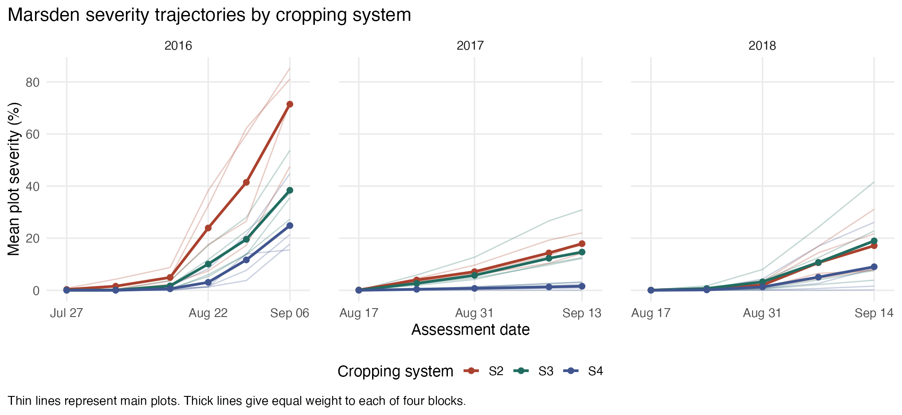
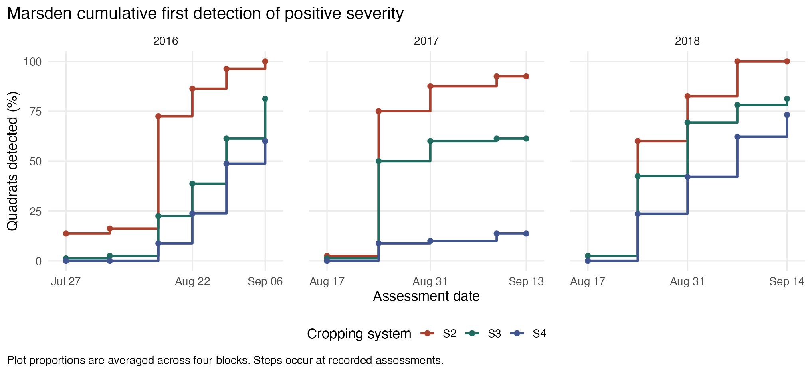

# Marsden disease trajectories and symptom timing, 2016–2018

November 22, 2026. A disease-only comparison of cropping systems using all rated quadrats and the archived plot assignments. [Protocol](PROTOCOL.md)

## Severity by cropping system

S4 had the lowest final mean severity in all three seasons. The gap was largest in 2016. S2 finished above S3 in 2016 and 2017, and below S3 in 2018. These are equal-block means from 12 main plots per season. The full 2017 disease cohort includes all 240 rated quadrats. The 2018 cohort has 115, with eight and seven quadrats in the S3 and S4 plots of block 4. [Plot sizes](plot_sizes.csv) · [Visit means](rotation_visit_means.csv)

| Season | Assessment window | Quadrats | S2 final severity | S3 final severity | S4 final severity | Whole-curve tail area |
|---|---|---:|---:|---:|---:|---:|
| 2016 | July 27–September 6 | 240 | 71.4% | 38.4% | 24.9% | 0.023 |
| 2017 | August 17–September 13 | 240 | 17.9% | 14.7% | 1.6% | 0.088 |
| 2018 | August 17–September 14 | 115 | 17.1% | 19.0% | 9.0% | 0.616 |

The 2017 final S2 minus S4 difference was **16.34 percentage points**, with a pointwise paired interval of 9.21 to 23.47. In 2018 that difference was **8.09 points**, with an interval of −26.26 to 42.44. Restricting 2018 to the three blocks with 10 rated quadrats per plot reduced the estimate to **3.60 points**. The annual whole-curve statistics and AUDPC gave similar conditional permutation tail areas. Those calculations treat complete plot profiles as exchangeable within blocks under the sharp null, and the annual windows span different periods. [Season contrasts](season_endpoint_contrasts.csv) · [2018 block sensitivity](marsden2018_block_sensitivity.csv) · [Conditional permutations](permutation.csv)

## First recorded detection

The mean fraction of quadrats ever rated positive by the final visit was higher for S2 than S4 in each season. The strongest separation was in 2017. The two systems reached **92.5%** and **13.8%**, respectively. Incidence and severity gave the same first-positive visit for all 240 quadrats in 2017 and differed for one of 115 in 2018. [Detection curves](rotation_detection.csv) · [Censoring counts](censoring_counts.csv)

Threshold choice mattered more. Relative to any positive severity, first reaching 5% changed the detected date or whether detection occurred by the final visit for **27 of 240** quadrats in 2017 and **95 of 115** in 2018. On August 24, 2018, block-weighted detection in S2 and S3 was 60.0% and 42.5% at the positive threshold, and 2.5% and 5.0% at 5% severity. These describe different stages of symptom development. [Threshold sensitivity](detection_definition_disagreements.csv)

## Timing and subsequent severity

The final S2 minus S4 gap can be expressed as a component associated with the fraction ever detected and a component associated with severity among detected quadrats. In 2016 the two components contributed about **23.3 points each**. In 2017 the detected-fraction component accounted for **10.8 of 14.5 points** in the three estimable block pairs. One S4 plot had no detected quadrats, so its positive-group mean was undefined. In 2018 the two components were **3.5 and 4.6 points**. [Final severity decomposition](final_severity_decomposition.csv)

The mean severity gains from first detection to the next measured visit for S2 and S4 were **3.61 and 1.89 points** in 2017, and **3.09 and 2.57 points** in 2018. The 2017 follow-up spans 4–9 days, compared with seven days in 2018. Only 11 S4 quadrats in three plots contribute the 2017 estimate. Conditioning on first detection selects different quadrats across systems and years. These observations do not isolate a causal effect on post-onset progression. [First-follow-up gain and eligible counts](first_followup_severity.csv)

## Next analysis

Use the annual detection bounds to build an explicit early-warning eligibility table. Define a landmark and future outcome window, retain the at-risk denominator, and compare rotation alone with the latest spectrum before adding any trajectory features. The 2018 threshold sensitivity makes endpoint choice consequential.

## Reproduce

Run `Rscript analysis/08_marsden_disease_seasons.R` from the repository root. An optional argument sets the output directory. The script verifies the disease input hash, audits the plot assignment and date keys, and writes the unit registry and bounds to the ignored `local/` folder. [R script](../../analysis/08_marsden_disease_seasons.R) · [Shared conditional permutation](../../analysis/marsden_disease_methods.R) · [Software versions](software.csv)
