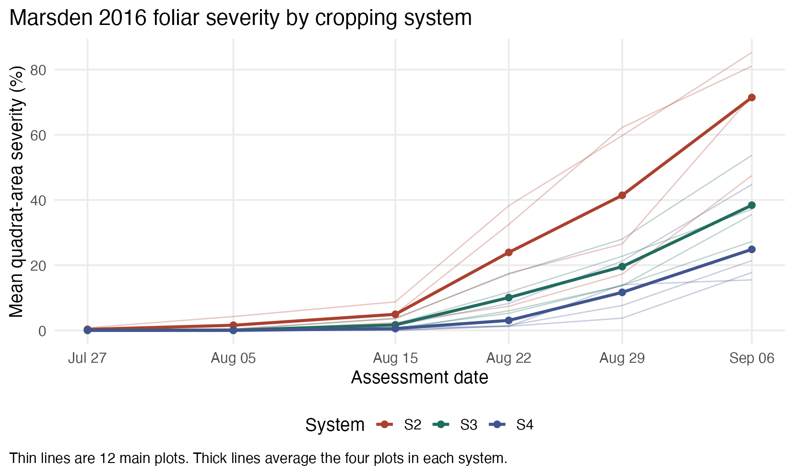

# Marsden 2016 longitudinal baseline

November 22, 2026. Exploratory Q1–Q2 analysis and source preparation for Hinds 2018. See the [protocol](PROTOCOL.md) for the estimand, formulas and comparison rules.

## Severity over six assessments

The Marsden cohort has 1,440 disease records from six assessments of 240 quadrats in 12 main plots. Each cropping system has one main plot in each of four blocks. The baseline averages quadrats within main plots and compares complete plot trajectories within blocks. The analysis window was July 27–September 6. Independent spectral data retain 23,040 band measurements from 12 acquisition dates. [Cohort coverage](marsden2016_cohort_coverage.csv) · [Plot-date means](marsden2016_plot_dates.csv)



| Cropping system | August 15 mean severity | August 22 mean severity | September 6 mean severity |
|---|---:|---:|---:|
| S2 | 4.9% | 23.9% | 71.4% |
| S3 | 1.7% | 10.1% | 38.4% |
| S4 | 0.6% | 3.1% | 24.9% |

Late-season means diverged substantially. The September 6 S2 minus S3 difference was **33.0 percentage points** (pointwise 95% interval 17.2–48.8), and S2 minus S4 was **46.6 points** (−1.0–94.2). The wider S2–S4 interval reflects variability among the four block contrasts. The exploratory global curve statistic had a conditional permutation tail area of **0.023** (30 of 1,296 assignments). The conventional AUDPC statistic gave the same tail area for this dataset. The test assumes exchangeability of the three included soybean-phase labels within each block under the sharp null. It does not isolate a shape effect from overall severity. [Dated differences and intervals](marsden2016_severity_contrasts.png) · [Conventional summary contrasts](marsden2016_summary_contrasts.csv) · [Permutation results](marsden2016_permutation.csv)

## What smoothing added

| Model | Leave-one-block-out RMSE | Mean absolute error | Predictions below 0% or above 100% |
|---|---:|---:|---:|
| Visit-factor baseline | 10.47 points | 6.29 points | 0 of 72 |
| Three-column natural spline | 10.42 points | 6.40 points | 11 of 72 |

The spline changed RMSE by **0.05 percentage points** and produced small negative early-season predictions, with a minimum of −0.85 points. The visit-factor model remains the working baseline. The smooth comparison gives little support for estimating derivatives from these six dates. The trajectory view locates the widening gaps in time. AUDPC summarizes the accumulated difference, and the within-trial evaluation gives little evidence of incremental predictive value from smoothing. [Held-out metrics by block](marsden2016_block_holdout.csv) · [Fitted visit means](marsden2016_curve_means.csv)

## First observed symptoms

By August 15, the fractions of quadrats with any positive severity rating were **72.5% for S2, 22.5% for S3 and 8.8% for S4**. Across systems, there were 12 first-visit positives and 47 quadrats still below the detection criterion at the last visit. Incidence-based onset intervals change the recorded first-positive date for five S4 quadrats. Mean severity among previously detected quadrats describes a changing subset, so that table supports exploration rather than a treatment effect on progression after onset. [Detection plot](marsden2016_detection.png) · [Censoring counts](marsden2016_onset_counts.csv) · [Plot-level detection and severity](marsden2016_detection_by_plot.csv)

## Hinds 2018 preparation

The source-keyed cohort joins the experiment sheet to 480 dated severity records and 60 sequence-verified harvest records. It retains the alternate severity values from the reproductive-stage worksheet. Those values differ on three plot-dates, all involving a change in positive status, with a largest difference of four percentage points. The spectral file keeps 3,344 eligible band rows and flags 24 rows for plots 507–508 on August 3. The two plots' disease and harvest records remain in their respective files. Incidence is pending denominator reconciliation. [Cohort coverage](hinds2018_cohort_coverage.csv) · [Severity version check](hinds_severity_version_check.csv)

## Next analysis

Use the Marsden 2016 endpoint and visit-factor baseline for a first disease–reflectance association protocol based on shared temporal support and predeclared bands. Keep acquisition and assessment dates explicit. Use the Hinds severity versions for a plot-level sensitivity check before selecting an onset definition. Extend the Marsden analysis using the field-backed 2017–2018 corrections with the same plot weighting and date support checks.

## Reproduce

Run both commands from the repository root. The archive argument enables the Hinds rebuild. A Marsden-only run can omit it. Prepared observation-level files are generated under the ignored `results/phase2/local/` directory, including separate tables for disease, reflectance and harvest where available. Source hashes are checked against the Phase 1 manifests. [Preparation script](../../analysis/03_prepare_phase2.R) · [Baseline script](../../analysis/04_marsden2016_baseline.R) · [Software versions](software.csv)

```sh
Rscript analysis/03_prepare_phase2.R results/phase2 "$SDS_PAPER_ROOT"
Rscript analysis/04_marsden2016_baseline.R results/phase2
```
