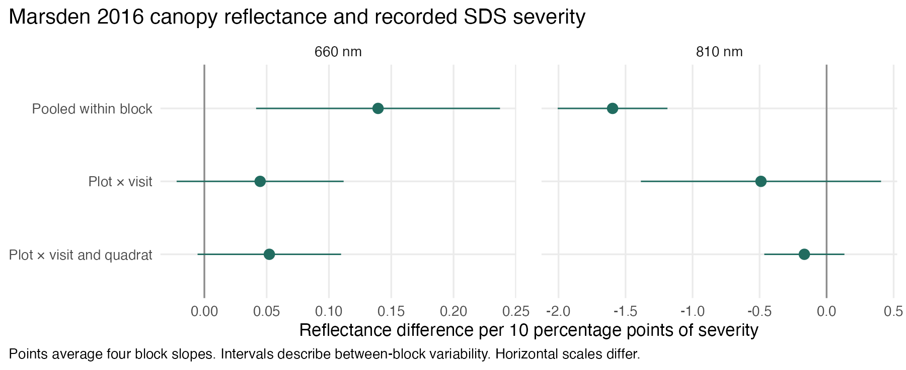

# Marsden 2016 disease–reflectance associations

November 22, 2026. Exploratory Q4 analysis of red (660 nm) and near-infrared (810 nm) canopy reflectance. [Protocol](PROTOCOL.md)

## Date support

Five of six severity assessments had a preceding reflectance acquisition within four days. The five date pairs include 240 quadrats, 12 plots and four blocks at each assessment, giving 1,200 quadrat-visits per band. Reflectance preceded two assessments by one day and three by four days. The August 29 rating was excluded because the preceding acquisition was 11 days earlier. The bracketing interpolation sensitivity comparison used the three shared assessments on August 5, August 15 and September 6. [Date support](marsden2016_date_support.csv)

## Association after adjustment

Values are reflectance percentage points per 10 percentage points of recorded severity. Each estimate averages the four block slopes equally.

| Band | Pooled within block | Adjusted for plot × visit | Adjusted for plot × visit and quadrat | Pointwise 95% interval for primary estimate |
|---|---:|---:|---:|---:|
| 660 nm | +0.139 | +0.045 | **+0.052** | −0.005 to +0.110 |
| 810 nm | −1.597 | −0.490 | **−0.166** | −0.465 to +0.133 |

Accounting for shared plot and visit differences and stable quadrat differences reduced both pooled associations. The red slope was positive in all four blocks, and the near-infrared slope was negative in three. Both primary intervals include zero. The large pooled near-infrared slope is sensitive to the adjustment for shared plot-season patterns. [Estimates and intervals](marsden2016_reflectance_estimates.csv) · [Block slopes](marsden2016_reflectance_block_slopes.csv)



## Sensitivity to dates

Omitting September 6 changed the adjusted red estimate from +0.052 to −0.004 and the near-infrared estimate from −0.166 to +0.064. Omitting each of the four earlier assessments individually preserved the primary signs. [Leave-one-assessment-out estimates](marsden2016_reflectance_leave_date_out.csv)

On the three shared assessments, using the nearest earlier acquisition gave estimates of +0.075 at 660 nm and −0.337 at 810 nm. Interpolating between the acquisitions before and after each rating gave +0.147 and −0.667, respectively. The interpolation estimates use later spectra and assume locally linear change. This comparison shows that the size of the associations depends on how acquisition and assessment dates are aligned. [Date-alignment sensitivity](marsden2016_reflectance_timing_sensitivity.csv)

## Interpretation and next analysis

The observed season supports a late-season association worth comparing across years. Its magnitude depends on plot and visit adjustment, the final rating date, and the use of later spectra. Each 2016 severity rating describes a quadrat one to four days after reflectance acquisition. Symptoms may already have been present at acquisition, so this analysis cannot establish pre-symptomatic detection. Plot-by-visit effects account for shared changes. Quadrats can still differ in local senescence, canopy cover and other time-varying conditions. The intervals describe between-block variability with four blocks. Previous SDS canopy work provides context for the two bands and their sensitivity to canopy condition. [Herrmann et al. 2018](https://www.mdpi.com/2072-4292/10/3/426)

Apply the same date rules to the source-corrected Marsden 2017 and 2018 cohorts. Compare each season separately on its observed support, retaining the last-visit sensitivity check. The Hinds severity-version comparison remains a separate analysis.

## Reproduce

Run from the repository root. The first command prepares the audited Marsden records and is only needed when the Phase 2 local output is absent. An optional first script argument sets the Phase 3 output directory and an optional second sets the Phase 2 output directory. The script verifies the primary slope against an explicit fixed-effects regression for each band and block. [Analysis script](../../analysis/05_marsden2016_reflectance.R) · [Software versions](software.csv)

```sh
Rscript analysis/03_prepare_phase2.R
Rscript analysis/05_marsden2016_reflectance.R
```
