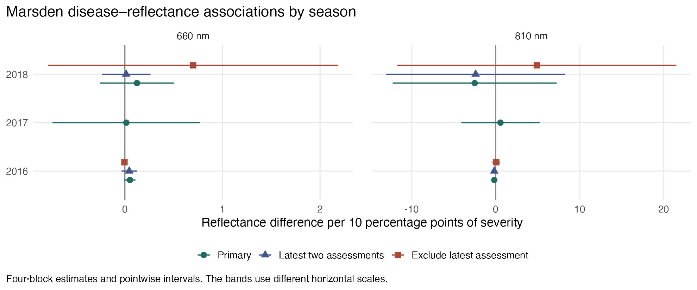

# Marsden disease–reflectance associations across 2016–2018

November 22, 2026. Exploratory comparison for Q4 and Q8. See the [protocol](PROTOCOL.md) for the date, wavelength and adjustment choices.

**The adjusted red estimate was positive in all three seasons, but small and imprecise. Near-infrared estimates changed sign across seasons and depended on the latest paired assessment.** Each season used the latest preceding or same-day acquisition within four calendar days of the rating.

## Source corrections and date support

Applied the audited metadata ledger to derived spectra. The 2017 correction changed 104 metadata cells across 48 band records for six June 30 quadrats. That acquisition predates the paired analysis window. The 2018 rotation correction changed 3,360 metadata cells across 420 quadrat-visits. Corrected labels agreed with the disease metadata for every linked quadrat. [Applied corrections](applied_metadata_corrections.csv)

| Season | Eligible vs recorded assessment dates | Eligible quadrats | Quadrat-visits per band | Latest eligible assessment |
|---|---:|---:|---:|---|
| 2016 | 5 of 6 | 240 | 1,200 | September 6 |
| 2017 | 2 of 5 | 120 | 240 | September 9 |
| 2018 | 3 of 5 | 115 | 329 | August 31 |

Only half of the 240 disease-rated quadrats in 2017 had spectra. In 2018, the August 23 acquisition paired to the August 24 rating lacked spectra for 16 quadrats, all in block 4. The 2018 primary model uses an incomplete panel and retains those quadrats' other visits. Two eligible 2018 pairs were same-day measurements with unknown ordering. The latest paired assessment fell at different points in the epidemics. Mean severity on that visit was 44.9% in 2016, 10.4% in 2017, and 2.3% in 2018. [Date support](date_support.csv) · [Coverage by block and rotation](block_date_support.csv) · [Severity support by block](severity_support.csv)

## Associations after adjustment

Values are reflectance percentage points per 10 percentage points of recorded severity. Estimates average the four within-block slopes after adjustment for quadrat and plot-by-visit effects. Intervals describe pointwise between-block uncertainty.

| Year | Red, 660 nm | Near infrared, 810 nm |
|---|---:|---:|
| 2016 | +0.052 (−0.005 to +0.110) | −0.166 (−0.465 to +0.133) |
| 2017 | +0.015 (−0.742 to +0.773) | +0.565 (−4.095 to +5.226) |
| 2018 | +0.125 (−0.254 to +0.503) | −2.501 (−12.262 to +7.260) |

Every primary interval included zero. Red block slopes agreed in direction in 2016, but were mixed in 2017 and 2018. The positive 2017 near-infrared mean combines three negative slopes with one positive slope of +4.904. The 2018 near-infrared block estimates ranged from −10.509 to +2.571. [All model specifications](estimates.csv) · [Individual block slopes](block_slopes.csv)

## Sensitivity to dates and incomplete records

- Limiting each season to its latest two eligible ratings kept all three red point estimates positive and close to zero. It also preserved the opposite near-infrared direction in 2017. These windows share a visit count and span different disease stages.
- Omitting the latest eligible assessment reversed the near-infrared sign in 2016 and 2018. The red sign also reversed in 2016. The 2017 within-quadrat model needs both eligible dates, so this sensitivity is unavailable for that season.
- Keeping only the 99 complete 2018 quadrats gave +0.084 at 660 nm and −2.825 at 810 nm, similar in direction to the all-eligible fit. Bracketing interpolation preserved the primary directions on common records in all years. It increased the 2016 magnitudes and changed the 2017 estimates appreciably. The interpolation uses observations after some rating dates. [Sensitivity estimates](sensitivity.csv)

## Interpretation

The red band is the more consistent directional lead across these three seasons. The size and precision of its estimates, the disagreement among blocks, and the unequal disease coverage limit what can be inferred. Near-infrared reflectance shows no stable adjusted direction across seasons. This comparison does not establish a pre-symptomatic signal. For any early-warning analysis, use independently defined at-risk quadrats, model the first positive assessment within a stated future window, and compare with cropping system alone.

The immediate independent analysis is the source-keyed Hinds severity-version sensitivity, which can proceed without resolving the two disputed reflectance acquisitions or the incidence denominators.

## Reproduce

Run `Rscript analysis/06_marsden_reflectance_seasons.R` from the repository root. An optional argument overrides the output folder. The script verifies both source hashes, checks the old metadata before each replacement, tests corrected metadata against disease records, and checks each primary coefficient against an explicit fixed-effects regression. It uses the [same date and slope functions](../../analysis/marsden_q4_methods.R) as the original 2016 analysis. [R script](../../analysis/06_marsden_reflectance_seasons.R) · [Software versions](software.csv)
